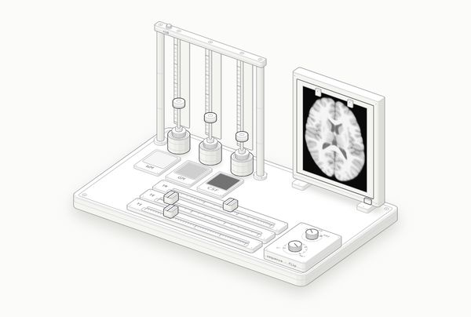

# MRI Physics Bench

Thirteen interactive instruments for teaching MRI physics, fMRI and diffusion, gathered into a tabbed web app with
missions, quick checks and a lab notebook. Every moving part runs on the real equation, and most instruments end on
the same brain slice so students can see what the physics does to an image.

**Open the app:** https://alirzar.github.io/mri-physics-bench/



## The instruments

| Fig | Instrument | What it teaches |
|---|---|---|
| 1 | Proton compass board | B0, the tiny proton excess, net magnetization |
| 2 | Larmor top and RF tuner | Precession, resonance, MR spectroscopy |
| 3 | Relaxation dome | T1 recovery, T2 decay, inversion and its null point |
| 4 | Contrast desk | Spin echo, inversion recovery (FLAIR) and gradient echo contrast |
| 5 | Spin-echo track | T2* dephasing, echo trains, spin echo versus gradient echo |
| 6 | ASL marble run | Arterial spin labelling: label, delay, subtract |
| 7 | k-space plotter | k-space, field of view, line by line versus EPI |
| 8 | Artifact clinic | Spike, motion, truncation, wrap-around, EPI ghost and distortion |
| 9 | BOLD balloon | Where the BOLD signal comes from (the balloon model) |
| 10 | HRF printing press | Convolution and design efficiency |
| 11 | GLM desk | Least-squares fitting, t values, false positives, FDR and FWE |
| 12 | Diffusion tray | Diffusion weighting, b-value, ADC, stroke on DWI |
| 13 | Tensor bench | Anisotropy, the diffusion tensor, colour FA, tractography |

## How it works

- Each instrument is an isometric SVG drawn with the Anatomy kit and driven by a small physics model (`model.mjs` in
  its folder): Boltzmann polarization, Bloch relaxation, spin-echo and gradient-echo signal equations, the pCASL
  kinetic model, Fourier reconstruction, the balloon model, the general linear model, Stejskal–Tanner diffusion and
  the diffusion tensor.
- Brain films are synthetic images built from the MNI152 2009c tissue probability maps (one axial slice at
  z = +14 mm). Fig 13 uses the Oxford-MM-1 DTI template.
- The app in `figures/course/` loads each instrument in a frame, reads its live readout to tick missions, and keeps
  progress and notes in the student's browser.
- Published as a claude.ai artifact, the app also offers a Claude tutor, a notebook download and a live lecture mode.
  On GitHub Pages those three stay hidden and everything else works.

## Building an instrument

Requirements: Node 20 or later, and Chrome for the screenshot and line checks.

```bash
cd figures/contrast-desk
node build.mjs           # dark theme: contrast-desk.html
node build.mjs --light   # light theme: contrast-desk-light.html
```

Copy both built pages into `figures/course/figures/` to update the app. Every push to `main` republishes
`figures/course/` to GitHub Pages.

Checks used while building:

```bash
node ../_anatomy/scripts/capture.mjs contrast-desk.html --out shots/check.png --width 900
node ../_anatomy/scripts/lines.mjs contrast-desk.html --out shots/lines.png
```

## Template data

The raw template files are not in the repository; the slices extracted from them are
(`figures/data/mni152-slice.json`, `figures/data/omm1-slice.json`), so every instrument builds without them. To
re-extract a slice (Python 3 with nibabel and numpy):

- **MNI152 2009c tissue maps.** Download `tpl-MNI152NLin2009cAsym_res-01_label-GM_probseg.nii.gz` and the `WM` and
  `CSF` versions from [TemplateFlow](https://www.templateflow.org/) into `figures/data/mni152/`, then run
  `python figures/data/extract_slice.py 14`.
- **Oxford-MM-1 DTI.** Download `OMM-1_DTI_FA.nii.gz` and `OMM-1_DTI_V1.nii.gz` from
  [osf.io/s9ge4](https://osf.io/s9ge4) into `figures/data/omm1/`, then run
  `python figures/data/extract_dti.py figures/data/omm1/OMM-1_DTI_FA.nii.gz figures/data/omm1/OMM-1_DTI_V1.nii.gz figures/data/omm1-slice.json 14`.

## Credits and licences

- Code and teaching material: MIT, see [LICENSE](LICENSE), with these exceptions.
- **Fig 13** contains data derived from the Oxford-MM-1 DTI template (Arthofer et al., Imaging Neuroscience 2024,
  doi:10.1162/imag_a_00361; built from UK Biobank data) and is licensed CC BY-SA 4.0; see
  [figures/tensor-bench/LICENSE.md](figures/tensor-bench/LICENSE.md).
- **MNI152 ICBM 2009c Nonlinear Asymmetric template** (Fonov et al., NeuroImage 2011), tissue maps via TemplateFlow.
  Copyright (C) 1993–2004 Louis Collins, McConnell Brain Imaging Centre, Montreal Neurological Institute, McGill
  University. Full notice in [figures/data/mni152/LICENSE.txt](figures/data/mni152/LICENSE.txt).
- **Anatomy isometric kit** in `figures/_anatomy/`, MIT License, by its own author.
- The order of the physics unit follows the Johns Hopkins Radiology video *MRI Physics: Magnetic Resonance and Spin
  Echo Sequences* (animation © 2022 Emily Wu). The video is not included, and the drawings are new.
- Models: Buxton et al. 1998 and Alsop et al. 2015 (ASL); Buxton, Wong and Frank 1998 and Friston et al. 2000 (balloon
  model); Friston et al. 1998 (canonical HRF); Benjamini and Hochberg 1995 (FDR); Stejskal and Tanner 1965,
  Le Bihan et al. 1986 and Moseley et al. 1990 (diffusion). The fMRI time courses, maps and the infarct are simulated.
